# Phase 10.4 — Demo website

_2026-10-25 · branch `phase10-demo` · `web/` served by `app.py` at `/` · consumes only the Phase 10.3 endpoints · production retrieval and gate unchanged_

## What it is

Three files — `web/index.html`, `web/style.css`, `web/app.js` — served as static assets by the
existing FastAPI app. **No build step, no framework, no CDN, no web fonts.** Every request the
page makes is same-origin to the 10.3 API, so the whole thing works offline on the Codespace,
and nothing is fetched from the internet at any point.

Sized for a projector: 17 px base type, high-contrast badges, readable at 1280×720 (every
screenshot below is exactly that viewport). A fixed footer on every view reads:

> Synthetic demo data — no proprietary TATA data is used. Cost/TAT figures are illustrative.

## The four tabs

### 1. Fleet (admin)

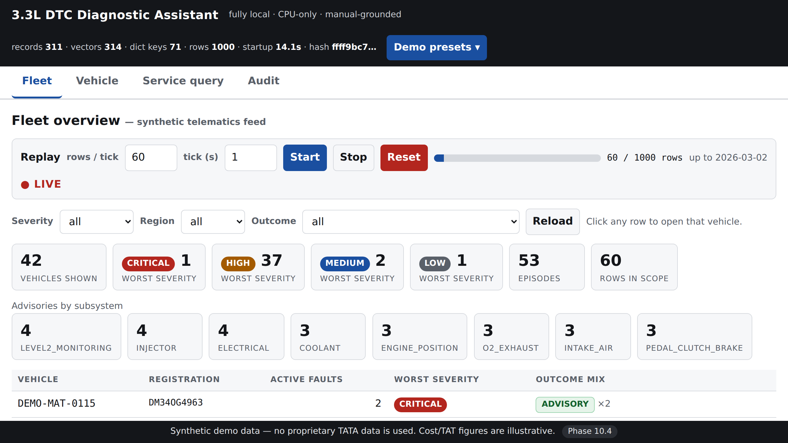

Counters for vehicles shown, worst severity (CRITICAL / HIGH / MEDIUM / LOW), episodes and rows
in scope, then advisories by subsystem, then the vehicle table: vehicle, registration, active
faults, worst severity, outcome mix. Filters for severity, region and outcome call
`GET /fleet?severity=&region=&outcome=`. **Clicking any row opens that vehicle in the Vehicle
tab.**

Severity badges: CRITICAL red, HIGH amber, MEDIUM blue, LOW grey. A vehicle whose only rows
were malformed has no severity at all and shows a plain dash — not a grey LOW badge, which
would read as a real rating.

The replay bar drives `POST /replay/start|stop|reset` and polls `GET /replay/status`. **The
page polls `/fleet` every 3 s only while a replay is active**, and stops polling the moment the
replay finishes or is stopped. In the screenshot the feed is at 60 of 1,000 rows, `● LIVE`, and
the counters reflect only what has arrived.

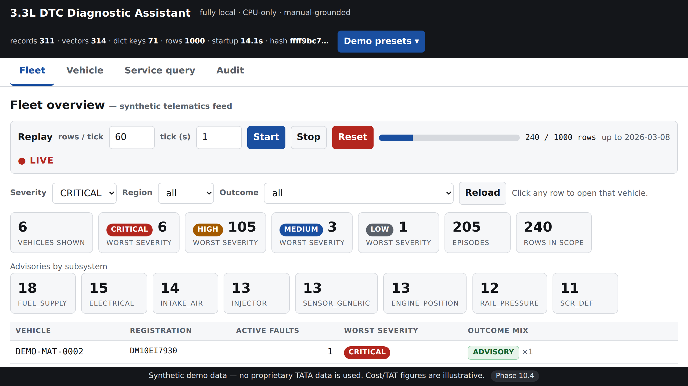

### 2. Vehicle

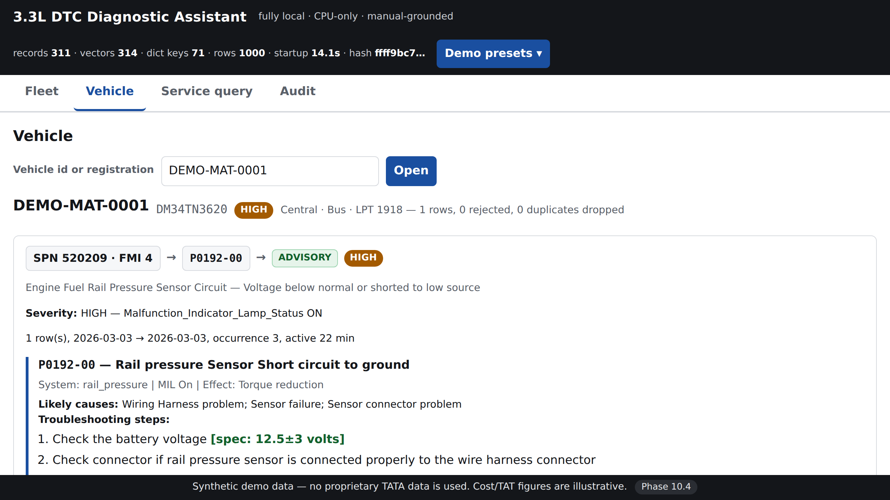

Enter a vehicle id or a registration (both resolve), or arrive by clicking a fleet row. Each
fault episode renders as a horizontal chain:

```
SPN 520209 · FMI 4   →   P0192-00   →   ADVISORY   HIGH
```

followed by the severity and the exact reasons that produced it. Then, by outcome:

- **ADVISORY** — the fix blocks: description, system, MIL, effect, likely causes, the ordered
  steps with their specs and branch logic (`→ if yes -> Step 13`), pins, and **Manual page N**.
- **AMBIGUOUS / CANDIDATES** — the candidate list under the text *"Not auto-advised — confirm
  with technician"*.
- **REFUSED / UNMAPPED** — the refusal message and **no steps at all**.
- **CLARIFY** — the clarification and the known variants, again with no steps.

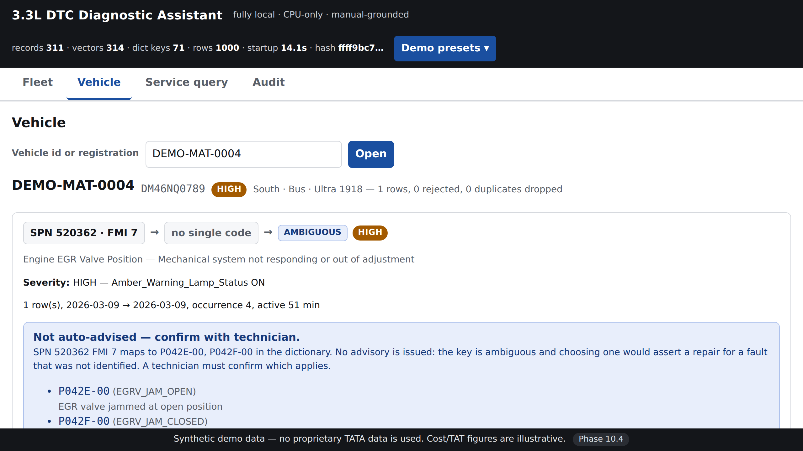

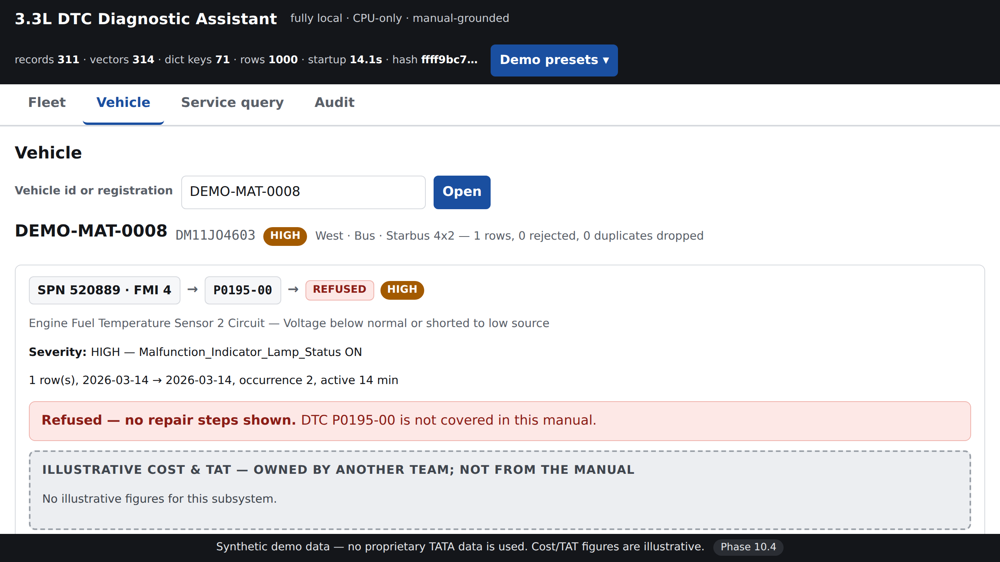

Cost and TAT sit in a visually separate panel — light grey, dashed border, different typography
— headed *"Illustrative cost & TAT — owned by another team; not from the manual"*. It can never
be mistaken for manual content.

The **Technician-reported code** box posts to `/verify-code`:

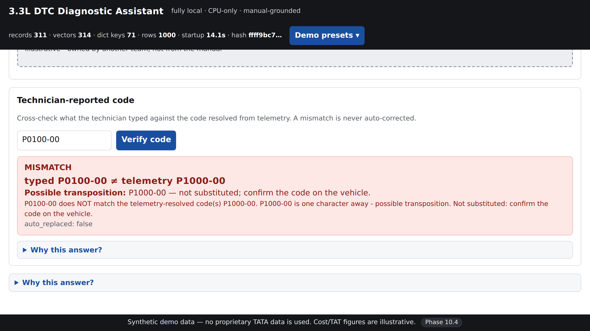

> **MISMATCH**
> **typed P0100-00 ≠ telemetry P1000-00**
> **Possible transposition:** P1000-00 — not substituted; confirm the code on the vehicle.
> `auto_replaced: false`

### 3. Service query (symptom)

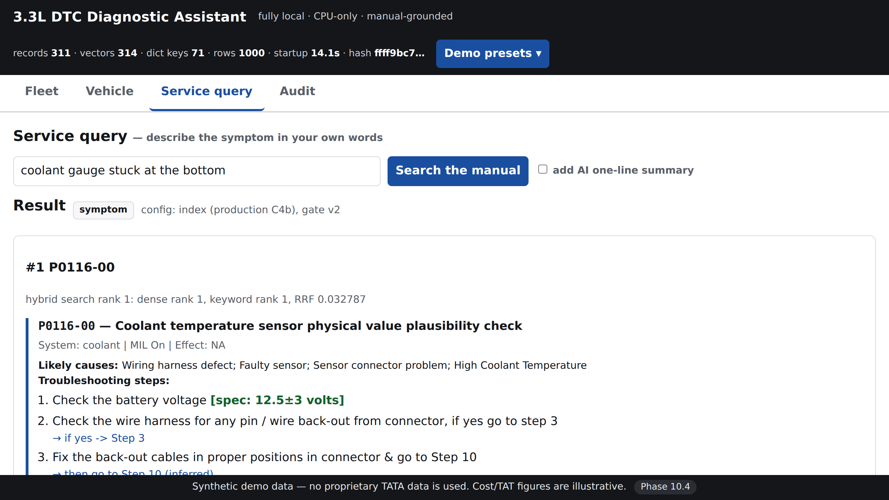

Free text → `POST /symptom` → the top-3 DTCs with full fix blocks and their illustrative
cost/TAT. An optional checkbox adds the one-line AI summary, which renders with a purple **AI**
badge so it is never confused with a repair step.

A refusal is rendered *as a refusal*, with its reason:

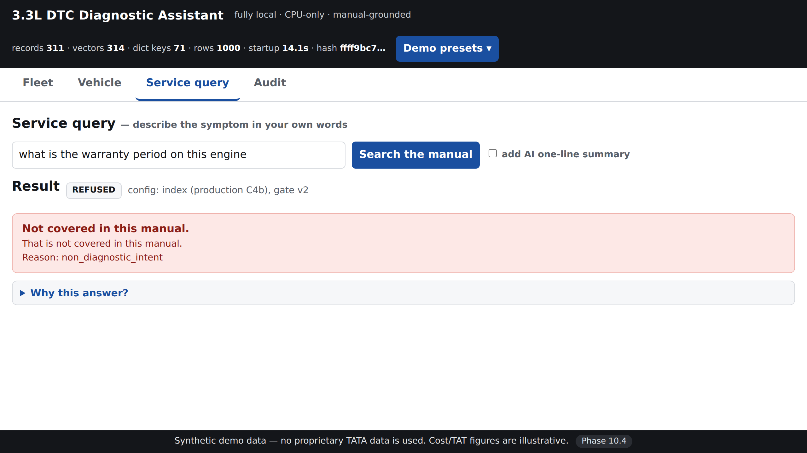

### 4. Audit

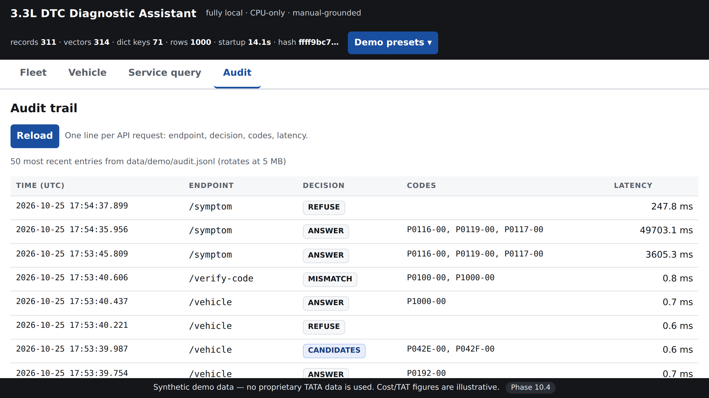

The latest 50 entries from `GET /audit`: time, endpoint, decision badge, codes, latency.

## "Why this answer?" on every result

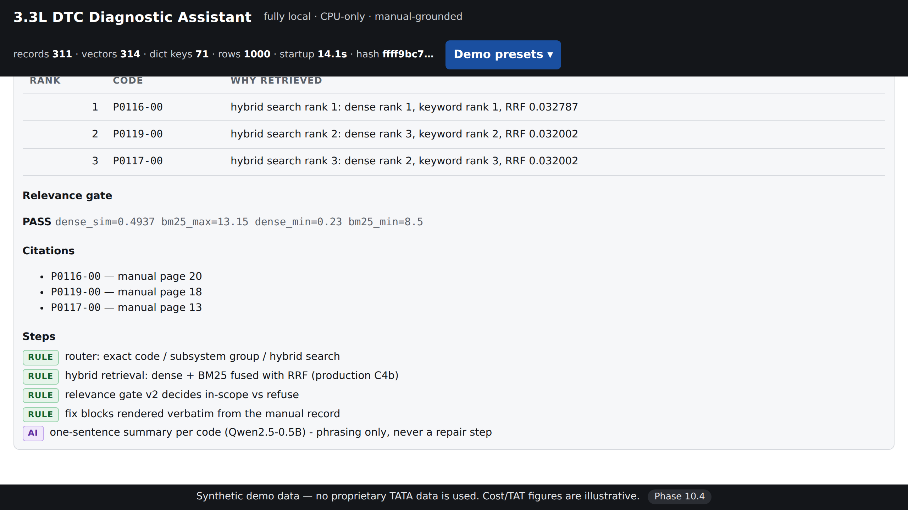

A collapsible panel attached to every result renders the 10.3 `why` block: the **route**, the
**retrieval ranks** (dense rank, keyword rank, RRF score per result), the **gate** decision with
its signals (`dense_sim=0.4937 bm25_max=13.15 dense_min=0.23 bm25_min=8.5`), the **citations**
with manual pages, the **severity reasons**, the **ladder rungs** on telematics routes, and the
**step list with RULE (green) and AI (purple) badges**.

The screenshot is the honest centrepiece of the demo: four RULE steps and exactly one AI step,
labelled *"phrasing only, never a repair step"*.

## Demo presets menu

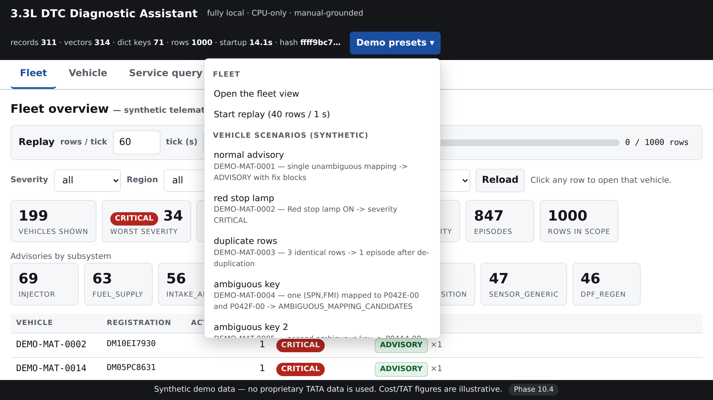

Built at load time from `GET /scenarios`, so it cannot drift from the data:

- **Fleet** — open the fleet view; start a replay at 40 rows/s.
- **Vehicle scenarios** — one button per scenario (all 14), each labelled with its vehicle and
  what it demonstrates.
- **Technician-reported code** — the two transposition cases: it opens the vehicle, fills the
  typed code and runs the check in one click.
- **Service query** — `coolant gauge stuck at the bottom` (in scope), `how do I change a tyre`
  and `what is the warranty period on this engine` (both expected to be refused).
- **Audit** — jump to the trail.

## A 10-minute demo script

| time | tab | what to do | what to say |
|---|---|---|---|
| 0:00–1:00 | Fleet | Open the page. Point at the header: 311 records, 314 vectors, startup 6 s, determinism hash. | "Everything runs locally on this machine. No cloud, no API keys. The hash pins the exact evaluated configuration." |
| 1:00–2:30 | Fleet | Presets → *Start replay*. Watch rows climb and the counters move. | "This is a synthetic telematics feed replaying 1,000 rows over 30 days. The fleet view only ever shows what has actually arrived." |
| 2:30–3:00 | Fleet | Filter severity = CRITICAL. | "Severity is deterministic: a red stop lamp is CRITICAL, full stop. Nothing escalates into CRITICAL on counts alone." |
| 3:00–5:00 | Vehicle | Click a CRITICAL row (or preset *normal advisory*). Walk the chain SPN/FMI → P-code → ADVISORY, then the steps. | "The code came from the dictionary and an exact lookup — not a similarity guess. Every step is the manual's own text, with the page number." |
| 5:00–5:30 | Vehicle | Point at the grey dashed cost panel. | "Cost and turnaround are illustrative and owned by another team. They are deliberately separated from manual content." |
| 5:30–6:30 | Vehicle | **Safety moment 1.** Preset *ambiguous key* (DEMO-MAT-0004). | "One SPN+FMI maps to both jammed-open and jammed-closed. The system refuses to choose and asks the technician. Guessing here would send someone to the wrong repair." |
| 6:30–7:30 | Vehicle | **Safety moment 2.** Preset *Type P0100-00 on DEMO-MAT-0011*. | "The technician typed a real code — just not this vehicle's. One character apart. We flag it and never auto-correct it." |
| 7:30–8:30 | Service query | Preset *coolant gauge stuck at the bottom*. | "Plain technician language, no code. Hybrid search over the manual returns the top 3 with full procedures." |
| 8:30–9:00 | Service query | **Safety moment 3.** Preset *what is the warranty period on this engine*. | "Out of scope is refused, not answered. That refusal is the feature." |
| 9:00–9:45 | any | Expand *Why this answer?* | "Retrieval ranks, the gate decision and its numbers, the citations, and every step labelled RULE or AI. Exactly one step is AI, and it only phrases." |
| 9:45–10:00 | Audit | Open the Audit tab. | "Every request is logged with its decision and latency, against the git commit and the determinism hash — so any answer in this demo can be reproduced later." |

**Before you present:** run the smoke driver — it exercises exactly what the preset menu does.

```bash
PYTHONPATH=src .venv/bin/python scripts/demo_smoke.py
# ==== DEMO SMOKE: 43/43 passed ====
```

## Running it

```bash
.venv/bin/uvicorn app:app --host 0.0.0.0 --port 8000
# then open http://127.0.0.1:8000/   (Codespace: forward port 8000; see phase10_3_api.md)
```

Port visibility, keep-alive and the `--host 0.0.0.0` requirement are documented in
[phase10_3_api.md](phase10_3_api.md#exposing-port-8000-in-the-codespace). **Set the port back to
Private after a demo** — a public port exposes the whole API, including `/audit`.

## Quality

- **Error handling.** Every fetch goes through one wrapper that parses the error body and shows
  it inline (`404 Not Found — no rows for vehicle …`). A failed request never leaves a blank
  view, and a 404 on the Vehicle tab adds a hint to use the presets. An unreachable API is
  reported as such in the header and inline.
- **No external requests.** No CDN, no web fonts, no analytics. Verified by inspection: the only
  URLs in `app.js` are same-origin API paths.
- **`scripts/demo_smoke.py` — 43/43.** Drives every preset through the API, in-process by
  default or against a live server with `--base http://127.0.0.1:8000`. It checks every scenario
  outcome, both transposition mismatches, the three symptom presets, the fleet filters, the
  replay lifecycle, the audit coverage, the static assets, and that every response carries a
  well-formed `why` block.
- **Screenshots** are captured from the real UI by `scripts/capture_screens.py` (headless
  Chromium at 1280×720, device scale 2). Playwright is a **dev-only** dependency, deliberately
  not in `requirements.txt`: the service and pipeline never need a browser.

  ```bash
  .venv/bin/pip install playwright && .venv/bin/playwright install chromium
  sudo .venv/bin/playwright install-deps chromium      # system libs for headless Chromium
  PYTHONPATH=src .venv/bin/python scripts/capture_screens.py
  ```

## Gates

| check | result |
|---|---|
| `scripts/demo_smoke.py` | **43/43** |
| `src/test_api.py` | **56/56** |
| smoke suite | **44 passed / 1 xfail / 0 failed** |
| determinism `--defaults` | **`ffff9bc707d8754d`** |

## Files

| file | role |
|---|---|
| `web/index.html` | the four tabs, the preset menu, the footer |
| `web/style.css` | projector-sized, high-contrast, light/dark tokens |
| `web/app.js` | all logic: fetch wrapper, renderers, why panels, replay polling |
| `scripts/demo_smoke.py` | preset driver, PASS/FAIL (new) |
| `scripts/capture_screens.py` | screenshot capture, dev-only (new) |
| `docs/report/img/phase10_4_*.png` | 11 screenshots |

## Limitations

1. **Single-user demo surface.** No authentication; the replay store and diagnosis sessions are
   per-process. Two uvicorn workers would not share them.
2. **The fleet table renders every vehicle** that passes the filters — fine at 199, wrong at
   fleet scale. No pagination or virtual scrolling.
3. **Polling, not streaming.** `/fleet` is re-fetched every 3 s during a replay; each call costs
   ~64 ms server-side because the ladder re-runs for all vehicles. A real version would stream
   increments.
4. **No persistence in the browser.** A refresh resets filters and the open tab; the replay
   state lives on the server and survives.
5. **The AI summary is slow on first use** (~15–30 s while the local model loads) and the
   checkbox gives no spinner beyond the "Searching the manual…" line. Leave it off unless the
   point being made is the RULE/AI distinction.
6. **Tested in headless Chromium only.** The CSS uses only widely-supported features and no
   build step, but the UI has not been exercised in Firefox or Safari.
